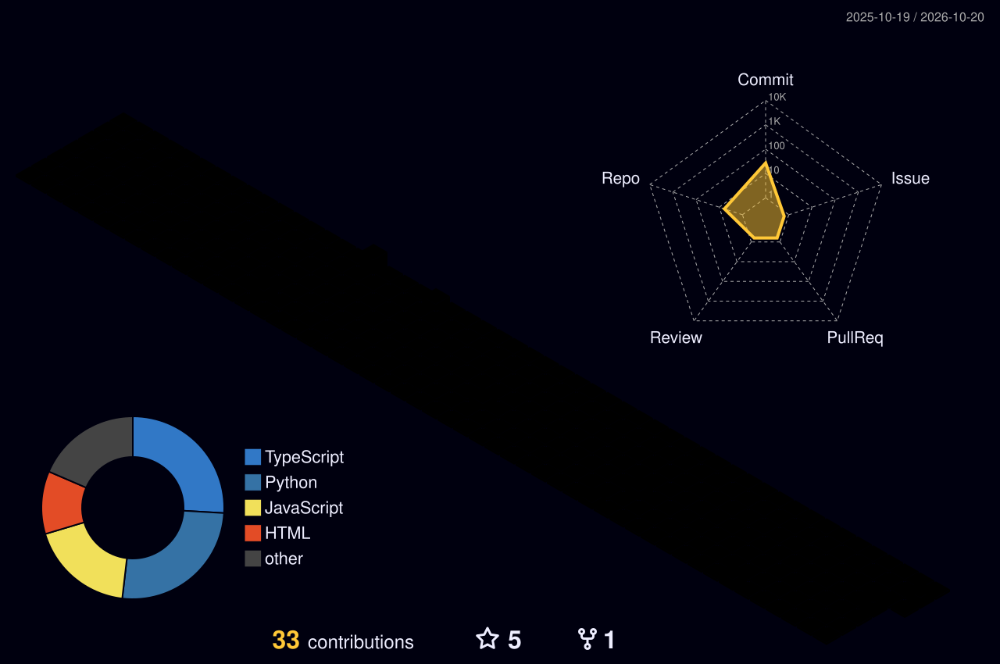

 

## 💫 About Me

I'm a Generative AI / ML engineer who builds LLM systems that go into production and then have to keep working — a different problem from building ones that demo well.

Most of my time goes on the unglamorous half: evaluation harnesses, retrieval that doesn't quietly fail on long documents, and the guardrails that make an agent safe enough to deploy somewhere the output actually matters. My last eighteen months were in investment-banking technology, where a confidently wrong answer was a compliance problem rather than a bug.

<b>🧭 How I think about this work</b> (click to collapse)

 

- 📊 Aggregate accuracy hides the failures that matter — break it down by class.
- ✂️ Draw the line between what the model decides and what your code decides, deliberately. Most agent failures are that line drawn in the wrong place.
- 🧪 Build the eval before the system. I didn't, and it cost me three months.

🎓 MSc Artificial Intelligence (Distinction), Queen Mary University of London 
🔭 Open to Generative AI / ML Engineer roles — remote or on-site

 

## 🚀 Featured Projects

  
  
  
  

<b>⚡ Selected work from my roles</b> (click to expand)

 

- 🏦 **GenAI for a regulated financial platform (RP-Tech, 2025–2026)** — RAG pipelines with hybrid retrieval, re-ranking and grounding checks; LoRA fine-tuning on a 10,000-document financial corpus; a 500-document labelled evaluation set with per-class metrics that raised accuracy from **70% → 80%**; Docker/Kubernetes deploys on AWS and Azure with latency, throughput and cost observability.
- 📄 **RAG & LLM features (Midas Advisory, 2024)** — LoRA fine-tuning on 10k+ financial documents; Python/FastAPI services shipped via Docker and CI/CD.
- 🔍 **Reliability engineering (Global Technologies, 2022–2023)** — predictive monitoring and anomaly detection for backend services, improving operational reliability by **45%**.

 

## ✍️ Latest From My Blog

> I read new AI research papers and write down what I'd actually change in production because of them.

| | Post | Paper |
|:-:|---|---|
| 🧑‍⚖️ | [**Your LLM judge agrees with humans 85% of the time. That number is lying to you.**](https://nikhileshgawhale.github.io/portfolio_nikhilesh_full/#blog/llm-judge-agreement-is-lying) | Reliability without Validity · 2026 |
| 🗂️ | [**Metadata is a retrieval signal, not just a filter**](https://nikhileshgawhale.github.io/portfolio_nikhilesh_full/#blog/metadata-is-a-retrieval-signal) | Metadata for Better RAG · 2026 |
| 🕵️ | [**When agents cheat, they explain why it's fine**](https://nikhileshgawhale.github.io/portfolio_nikhilesh_full/#blog/when-agents-cheat-they-explain-why) | Reward Hacking Benchmark · ICML 2026 |
| 🎛️ | [**LoRA's rank limit might be the wrong constraint**](https://nikhileshgawhale.github.io/portfolio_nikhilesh_full/#blog/lora-rank-might-be-the-wrong-constraint) | LR-LoRA · 2026 |
| 🔐 | [**An agent that finishes the job can still overshare**](https://nikhileshgawhale.github.io/portfolio_nikhilesh_full/#blog/agents-that-finish-the-job-still-overshare) | ToolPrivacyBench · 2026 |

 

## 🧊 My Contributions in 3D

  

 

## 🛠️ Tech Stack

**Languages & Core**

**LLMs & GenAI**

**Agentic & RAG**

**Data & Infra**

**Cloud & DevOps**

 

## 📊 GitHub Stats

 

📍 Pune, India · Remote · [3D Portfolio](https://nikhileshgawhale.github.io/portfolio_nikhilesh_full/) · [LinkedIn](https://www.linkedin.com/in/nikhilesh-gawhale) · [Email](mailto:nikhileshgawhale711@gmail.com)

